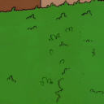
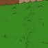
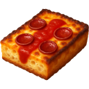
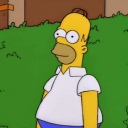
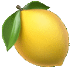
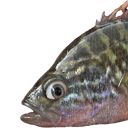

# emoji

My custom Slack emoji, 376 images plus 9 aliases (see [manifest.csv](manifest.csv)).

| | | | | | |
|---|---|---|---|---|---|
|  `:ad:` |  `:advisory-db:` |  `:all-seeing-lemon:` |  `:ash-wednesday:` |  `:befriendabot:` |  `:big-orca:` |
|  `:big-turtle:` |  `:blink-blob:` |  `:blurbo-nod:` |  `:blurbo-shake:` |  `:buddys-pizza:` |  `:bush:` |
|  `:bush_james:` |  `:buzzfeed_ack:` |  `:buzzfeed_adr:` |  `:buzzfeed_edr:` |  `:caps-lock:` |  `:chef-kiss-2:` |
|  `:citrus-heart:` |  `:cod-review:` |  `:code-koala-tea:` |  `:critterbandit:` |  `:crittermike-bounce:` |  `:crittermike-jam:` |
|  `:crittermike-on-fire:` |  `:crittermike-pet:` |  `:crittermike-wiggle:` |  `:crittermike_intensifies:` |  `:dependabot-thinkies:` |  `:dependabot_flippy:` |
|  `:dependabutt:` |  `:dependabutt-day:` |  `:derpendabot:` |  `:detroit-style-pizza:` |  `:diffpendabot:` |  `:drama-nod-hd:` |
|  `:drama-shake-hd:` |  `:emoji-matrix:` |  `:excited-hd:` |  `:figaro:` |  `:freddy:` |  `:ftw:` |
|  `:ghost-mona:` |  `:go-big:` |  `:good-point-hd:` |  `:hmmyes-jittery-hd:` |  `:holycow:` |  `:homer_stay:` |
|  `:hubot-ghsa:` |  `:hubot-improved:` |  `:hubot-spinning-improved:` |  `:hubutt:` |  `:james_bush:` |  `:laserlemon:` |
|  `:laserlemon-logo:` |  `:left-drama-nod-hd:` |  `:left-neutral:` |  `:left-nod-hd:` |  `:left-slow-nod-hd:` |  `:left-super-nod-hd:` |
|  `:left-turbo-nod-hd:` |  `:left_speech_balloon:` |  `:left_writing_hand:` |  `:lemon_intensifies:` |  `:lemon_over_mountains:` |  `:lemonbeer:` |
|  `:lemonbikini:` |  `:lemonchart:` |  `:lemoncool:` |  `:lemoneyes:` |  `:lemonlaunch:` |  `:lemonrise:` |
|  `:lemonrock:` |  `:lemonrocket:` |  `:lemonsleep:` |  `:lemontongue:` |  `:lemonwolf:` |  `:lets-just-say-i-put-my-eye-on-a-fish:` |
|  `:melting-face:` |  `:monkey-wrench:` |  `:morning_deintensifies:` |  `:mr-lemon:` |  `:mr-peanut:` |  `:neutral:` |
|  `:nod-agree-hd:` |  `:nod-hd:` |  `:octicon-book:` |  `:octicon-filter:` |  `:octicon-goal:` |  `:octicon-history:` |
|  `:octicon-hubot:` |  `:octicon-iterations:` |  `:octicon-lemon:` |  `:octicon-milestone:` |  `:octicon-people:` |  `:octicon-project:` |
|  `:octicon-repo:` |  `:openclaw:` |  `:outrageousorange:` |  `:panerabot:` |  `:partyparrot-hd:` |  `:pb--check:` |
|  `:pb--clock:` |  `:pb--x:` |  `:pb-b-a:` |  `:pb-b-o:` |  `:pb-b-z:` |  `:pb-bbbb:` |
|  `:pb-bbbg:` |  `:pb-bbbo:` |  `:pb-bbbr:` |  `:pb-bbbw:` |  `:pb-bbby:` |  `:pb-bbgg:` |
|  `:pb-bbgo:` |  `:pb-bbgr:` |  `:pb-bbgw:` |  `:pb-bbgy:` |  `:pb-bboo:` |  `:pb-bbor:` |
|  `:pb-bbow:` |  `:pb-bbrr:` |  `:pb-bbrw:` |  `:pb-bbww:` |  `:pb-bbyo:` |  `:pb-bbyr:` |
|  `:pb-bbyw:` |  `:pb-bbyy:` |  `:pb-bggg:` |  `:pb-bggo:` |  `:pb-bggr:` |  `:pb-bggw:` |
|  `:pb-bggy:` |  `:pb-bgoo:` |  `:pb-bgor:` |  `:pb-bgow:` |  `:pb-bgrr:` |  `:pb-bgrw:` |
|  `:pb-bgww:` |  `:pb-bgyo:` |  `:pb-bgyr:` |  `:pb-bgyw:` |  `:pb-bgyy:` |  `:pb-booo:` |
|  `:pb-boor:` |  `:pb-boow:` |  `:pb-borr:` |  `:pb-borw:` |  `:pb-boww:` |  `:pb-brrr:` |
|  `:pb-brrw:` |  `:pb-brww:` |  `:pb-bwww:` |  `:pb-byoo:` |  `:pb-byor:` |  `:pb-byow:` |
|  `:pb-byrr:` |  `:pb-byrw:` |  `:pb-byww:` |  `:pb-byyo:` |  `:pb-byyr:` |  `:pb-byyw:` |
|  `:pb-byyy:` |  `:pb-g-a:` |  `:pb-g-o:` |  `:pb-g-z:` |  `:pb-gggg:` |  `:pb-gggo:` |
|  `:pb-gggr:` |  `:pb-gggw:` |  `:pb-gggy:` |  `:pb-ggoo:` |  `:pb-ggor:` |  `:pb-ggow:` |
|  `:pb-ggrr:` |  `:pb-ggrw:` |  `:pb-ggww:` |  `:pb-ggyo:` |  `:pb-ggyr:` |  `:pb-ggyw:` |
|  `:pb-ggyy:` |  `:pb-gooo:` |  `:pb-goor:` |  `:pb-goow:` |  `:pb-gorr:` |  `:pb-gorw:` |
|  `:pb-goww:` |  `:pb-grrr:` |  `:pb-grrw:` |  `:pb-grww:` |  `:pb-gwww:` |  `:pb-gyoo:` |
|  `:pb-gyor:` |  `:pb-gyow:` |  `:pb-gyrr:` |  `:pb-gyrw:` |  `:pb-gyww:` |  `:pb-gyyo:` |
|  `:pb-gyyr:` |  `:pb-gyyw:` |  `:pb-gyyy:` |  `:pb-o-a:` |  `:pb-o-o:` |  `:pb-o-z:` |
|  `:pb-oooo:` |  `:pb-ooor:` |  `:pb-ooow:` |  `:pb-oorr:` |  `:pb-oorw:` |  `:pb-ooww:` |
|  `:pb-orrr:` |  `:pb-orrw:` |  `:pb-orww:` |  `:pb-owww:` |  `:pb-p-a:` |  `:pb-p-o:` |
|  `:pb-p-z:` |  `:pb-pbbb:` |  `:pb-pbbg:` |  `:pb-pbbo:` |  `:pb-pbbr:` |  `:pb-pbbw:` |
|  `:pb-pbby:` |  `:pb-pbgg:` |  `:pb-pbgo:` |  `:pb-pbgr:` |  `:pb-pbgw:` |  `:pb-pbgy:` |
|  `:pb-pboo:` |  `:pb-pbor:` |  `:pb-pbow:` |  `:pb-pbrr:` |  `:pb-pbrw:` |  `:pb-pbww:` |
|  `:pb-pbyo:` |  `:pb-pbyr:` |  `:pb-pbyw:` |  `:pb-pbyy:` |  `:pb-pggg:` |  `:pb-pggo:` |
|  `:pb-pggr:` |  `:pb-pggw:` |  `:pb-pggy:` |  `:pb-pgoo:` |  `:pb-pgor:` |  `:pb-pgow:` |
|  `:pb-pgrr:` |  `:pb-pgrw:` |  `:pb-pgww:` |  `:pb-pgyo:` |  `:pb-pgyr:` |  `:pb-pgyw:` |
|  `:pb-pgyy:` |  `:pb-pooo:` |  `:pb-poor:` |  `:pb-poow:` |  `:pb-porr:` |  `:pb-porw:` |
|  `:pb-poww:` |  `:pb-ppbb:` |  `:pb-ppbg:` |  `:pb-ppbo:` |  `:pb-ppbr:` |  `:pb-ppbw:` |
|  `:pb-ppby:` |  `:pb-ppgg:` |  `:pb-ppgo:` |  `:pb-ppgr:` |  `:pb-ppgw:` |  `:pb-ppgy:` |
|  `:pb-ppoo:` |  `:pb-ppor:` |  `:pb-ppow:` |  `:pb-pppb:` |  `:pb-pppg:` |  `:pb-pppo:` |
|  `:pb-pppp:` |  `:pb-pppr:` |  `:pb-pppw:` |  `:pb-pppy:` |  `:pb-pprr:` |  `:pb-pprw:` |
|  `:pb-ppww:` |  `:pb-ppyo:` |  `:pb-ppyr:` |  `:pb-ppyw:` |  `:pb-ppyy:` |  `:pb-prrr:` |
|  `:pb-prrw:` |  `:pb-prww:` |  `:pb-pwww:` |  `:pb-pyoo:` |  `:pb-pyor:` |  `:pb-pyow:` |
|  `:pb-pyrr:` |  `:pb-pyrw:` |  `:pb-pyww:` |  `:pb-pyyo:` |  `:pb-pyyr:` |  `:pb-pyyw:` |
|  `:pb-pyyy:` |  `:pb-qr:` |  `:pb-r-a:` |  `:pb-r-o:` |  `:pb-r-z:` |  `:pb-rrrr:` |
|  `:pb-rrrw:` |  `:pb-rrww:` |  `:pb-rwww:` |  `:pb-w-a:` |  `:pb-w-o:` |  `:pb-w-z:` |
|  `:pb-wwww:` |  `:pb-y-a:` |  `:pb-y-o:` |  `:pb-y-z:` |  `:pb-yooo:` |  `:pb-yoor:` |
|  `:pb-yoow:` |  `:pb-yorr:` |  `:pb-yorw:` |  `:pb-yoww:` |  `:pb-yrrr:` |  `:pb-yrrw:` |
|  `:pb-yrww:` |  `:pb-ywww:` |  `:pb-yyoo:` |  `:pb-yyor:` |  `:pb-yyow:` |  `:pb-yyrr:` |
|  `:pb-yyrw:` |  `:pb-yyww:` |  `:pb-yyyo:` |  `:pb-yyyr:` |  `:pb-yyyw:` |  `:pb-yyyy:` |
|  `:pb__failed:` |  `:pb__passed:` |  `:pb__pending:` |  `:progress-bar-done:` |  `:progress-bar-done-end:` |  `:progress-bar-done-start:` |
|  `:progress-bar-loading:` |  `:progress-bar-loading-end:` |  `:progress-bar-loading-start:` |  `:progress-done:` |  `:progress-error:` |  `:progress-loading:` |
|  `:psllol:` |  `:pumpkin-space-latte:` |  `:red-solo-cup:` |  `:runner-right:` |  `:second-responder:` |  `:security-products-growth:` |
|  `:shake-hd:` |  `:shit-list:` |  `:slow-nod-hd:` |  `:slow-shake-hd:` |  `:spg-platform:` |  `:squash-merge:` |
|  `:super-nod-hd:` |  `:super-shake-hd:` |  `:sync:` |  `:thai-spicy:` |  `:therapy:` |  `:thinking-about-lemon:` |
|  `:thinking-about-lemon-intensifies:` |  `:turbo-neutral:` |  `:turbo-nod-hd:` |  `:turbo-shake-hd:` |  `:turbo-waggle-hd:` |  `:underlisten:` |
|  `:waggle-hd:` |  `:webhook:` |  `:yeah-but-taxes:` |  `:yml:` |  |  |
